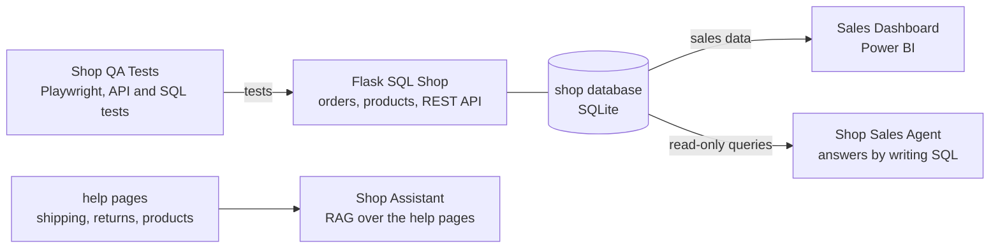

## Hi, I'm Weronika

Final-year IT engineering student and Junior Service Support Specialist at Żabka Polska, where I work every day with SAP, Power BI and operational data. I build software end to end in Python, from relational data models and REST APIs to tests, Docker, CI and cloud deployment, and I'm especially interested in applications built with large language models.

Looking for my first role as a Junior Python, Backend or Full-stack Developer, QA Automation Engineer or Junior Data Analyst.

Poznań, Poland (open to relocating to Warsaw)

### One coffee shop, five projects

Five of my projects are built around the same fictional online coffee shop, so together they work like the systems of one small company: the shop itself, its tests, its sales report, an analyst that answers questions about sales, and a help assistant for customers.

| Project | What it does | Built with |
|---|---|---|
| [Flask SQL Shop](https://github.com/weronikategos/flask-sql-shop) | The shop: hand-designed database, orders, a REST API and a sales report | Flask, SQL, Docker |
| [Shop QA Tests](https://github.com/weronikategos/shop-qa-tests) | Test plan, test cases, 2 reported bugs, and API, E2E and SQL tests running daily in CI | pytest, Playwright, Postman, SQL |
| [Sales Dashboard](https://github.com/weronikategos/sales-dashboard-powerbi) | Sales report with a star schema, DAX measures, time analysis and customer cohorts | Power BI, DAX, SQL, pandas |
| [Shop Sales Agent](https://github.com/weronikategos/shop-sales-agent) | Answers sales questions by writing its own SQL, with read-only guardrails and evals | Python, Gemini API (function calling), SQL |
| [Shop Assistant (RAG)](https://github.com/weronikategos/shop-assistant-rag) | Answers customer questions from the help pages with cited sources, as a REST API with token and cost monitoring and evals | Python, Gemini API, Chroma, FastAPI, Docker |

### Other projects

| Project | What it does | Built with |
|---|---|---|
| [FreshPunkt Dashboard](https://github.com/weronikategos/Freshpunkt-dashboard) | Full-stack logistics and ordering system for a franchise network, with JWT login, roles and inventory alerts | FastAPI, SQLAlchemy, PostgreSQL, React, Docker |
| [Store Insights Pipeline](https://github.com/weronikategos/store-insights-pipeline) | Cloud sales data pipeline with the whole infrastructure defined as code | Azure Functions, Azure SQL, Terraform, Power BI |
| [AI Ticket Triage](https://github.com/weronikategos/ai-ticket-triage) | Categorises support tickets, scores priority and sentiment, and drafts replies | Python, LLM API, Pydantic, Streamlit |
| [SMS Spam Detector](https://github.com/weronikategos/sms-spam-detector) | ML model that detects spam SMS (F1 0.955), with a web app and REST API ([live demo](https://sms-spam-detector-btny.onrender.com)) | scikit-learn, Flask, Docker |
| [Book Market Scraper](https://github.com/weronikategos/book-market-scraper) | Scrapes 1000 books into SQLite and analyses prices, with a weekly run in GitHub Actions | requests, BeautifulSoup, SQLite, pandas |
| [TableFlow](https://github.com/weronikategos/Tableflow) | Android app for table reservations and orders, with JUnit tests for the pricing and booking logic | Kotlin, Jetpack Compose, Room |

### Tech stack
- **Backend:** Python, FastAPI, Flask, SQLAlchemy, REST APIs
- **Data:** SQL, PostgreSQL, SQLite, pandas, Power BI, DAX, Power Query
- **AI:** LLM APIs, function calling, RAG, embeddings, Chroma (vector database), evals
- **QA:** pytest, Playwright, Postman, API testing, test cases, bug reports
- **Frontend:** React, HTML/CSS/JavaScript
- **Cloud and tools:** Azure, Terraform, Docker, GitHub Actions, Render, Git

### Contact
[LinkedIn](https://www.linkedin.com/in/weronika-t%C4%99gos-1b44a9261/)
